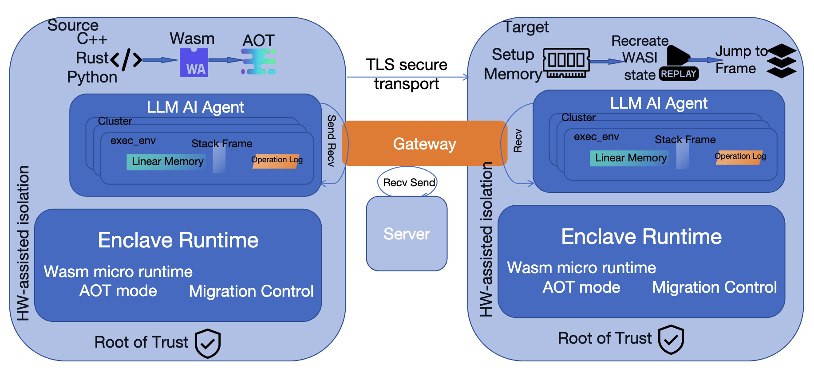
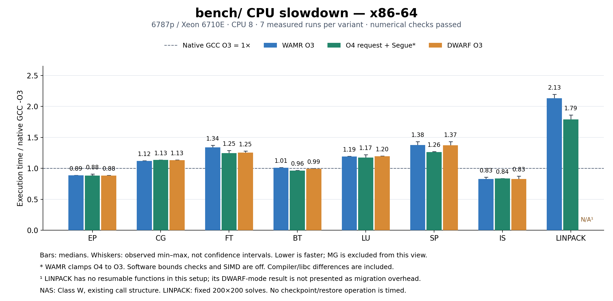

# Migratable Velocity Virtual Machine
[](https://github.com/Multi-V-VM/MVVM/actions/workflows/build-windows.yml)[](https://github.com/Multi-V-VM/MVVM/actions/workflows/build-macos.yml)[](https://github.com/Multi-V-VM/MVVM/actions/workflows/build-ubuntu.yml)[](https://github.com/Multi-V-VM/Multi-V-VM.github.io/actions/workflows/mkdocs.yml)

## DWARF + NVIDIA GPU continuation

The working branch integrates registered GPU allocations and the checked
`tensor-wasm-jit` kernel into the native DWARF checkpoint flow. Wasm uses stable
integer handles; a new process restores GPU memory and remaps those handles
before rebuilding the native call chain. CPU and GPU state are authenticated
together in one encrypted snapshot. Build and reproduction instructions are in
[docs/DWARF_GPU.md](docs/DWARF_GPU.md).

Measured on 6787p on 2026-11-07: RTX PRO 6000 Blackwell Server Edition,
Ubuntu 24.04 / kernel 6.8.0-106, NVIDIA 590.48.01, QEMU 10.0.94,
one vCPU, 4 GiB RAM and `idle=poll`; GCC 16 with C++26 reflection.
The same guest image, Wasm/AOT/debug artifacts and runner were used in both
modes. GPU kernels are translated from Wasm by `tensor-wasm-jit`.

| Check | Result |
|---|---|
| Combined GCC 16 / C++26 runner | Built in an Ubuntu 24.04 container; executed in both guests |
| CPU native DWARF regression | 12 x86 restore positions and 7 rejection cases; RISC-V unit tests 2/2 |
| Standalone production GPU CC preflight | 384 source-Wasm/GPU comparisons and restored-context execution |
| Real-Wasm DWARF + GPU process replacement | First/middle/final checkpoints passed in CC-On and CC-Off |
| Snapshot/invocation rejection | Modified ciphertext, wrong key and wrong root argument rejected in both modes |
| Repeated performance experiment | 1,000 and 10,000 iterations, 5 repetitions per configuration |

The workload checkpoints after a GPU kernel completes but before its result
reaches Wasm memory. A fresh process restores the native call chain, device
output and an additional 1 MiB device allocation. Result, side effects and
GPU launch counts are checked: the 16-iteration middle-checkpoint test returns
2321 with 16 effects, executing 8 GPU operations before saving and exactly 8
after restoring, with 2 native frames and 24 DWARF slots.

Measured medians; times in milliseconds. Both modes use the same Wasm and runner binary.

| Iterations | KVM / CC-Off AOT | TDX / CC-On AOT | TDX / CC-On DWARF | Combined CC overhead (AOT) | DWARF overhead (CC-On) |
|---:|---:|---:|---:|---:|---:|
| 1000 | 27.495 | 69.628 | 69.035 | +153.24% | -0.85% |
| 10000 | 251.444 | 640.219 | 642.449 | +154.62% | +0.35% |

Combined CC overhead includes TDX, GPU CC and the strict runtime path; it does not isolate GPU encryption.

| Mode | Iterations | Uninterrupted process | Save + restore processes | Added migration time (paired median) | Migration overhead (ratio of medians) | Destination recovery | Snapshot bytes |
|---|---:|---:|---:|---:|---:|---:|---:|
| plain | 1000 | 296.822 | 617.436 | 322.121 | +108.02% | 301.413 | 2231800 |
| plain | 10000 | 529.476 | 839.834 | 317.035 | +58.62% | 413.538 | 2231800 |
| cc | 1000 | 4030.765 | 10115.735 | 6091.836 | +150.96% | 5034.625 | 2244155 |
| cc | 10000 | 4551.230 | 10740.713 | 6156.807 | +136.00% | 5369.535 | 2244155 |

| Mode | Iterations | CPU capture | GPU capture + outer encryption | GPU restore | Native stack restore | Save-process attestation | Restore-process attestation |
|---|---:|---:|---:|---:|---:|---:|---:|
| plain | 1000 | 16.848 | 9.277 | 0.858 | 1.590 | 0.000 | 0.000 |
| plain | 10000 | 16.033 | 8.688 | 0.862 | 1.518 | 0.000 | 0.000 |
| cc | 1000 | 20.484 | 1042.687 | 1028.857 | 1.774 | 2008.892 | 1995.440 |
| cc | 10000 | 19.974 | 1013.680 | 1028.622 | 1.912 | 2038.618 | 2018.341 |

Attestation is included in the relevant phase and process totals, not added again.
The workload launches four SIMD lanes at a time and keeps 1 MiB of additional device state. These are small-kernel/process-migration measurements, not GPU peak-throughput or LLM results.
Each mode passed first/middle/last checkpoint recovery and 3 negative cases; each timing uses 5 repetitions. Raw samples and min/max are retained in the JSON artifacts.

At 10,000 iterations, the measured DWARF execution difference is **+0.35%**;
the -0.85% difference at 1,000 iterations is not evidence of a speedup.
CC migration adds a paired median **6.157 seconds**, while native stack restore
is **1.912 ms**. GPU initialization and remote attestation dominate the
process-level cost. These five-sample sequential measurements do not establish
statistical significance for sub-percent execution differences.

[Raw samples, phase timings, hashes and platform records](artifact/result/dwarf_gpu_6787p/)
are retained alongside the [reproduction procedure](docs/DWARF_GPU.md).
Migration here is local replacement by a new process on the same GPU; network
transfer, cross-GPU restore and an application-scale workload were not measured.
The driver rejects CC-Off inside TDX, so the comparator uses regular KVM with
CC-Off and measures the whole CC configuration rather than GPU encryption alone.

Earlier eight-vCPU and one-vCPU guests experienced stalls. After an authorized
host restart, this one-vCPU polling configuration completed both experiments.
It does not establish long-duration SMP stability or isolate the earlier fault;
see the [platform follow-up](docs/NVIDIA_CC.md#dwarf-integration-follow-up).
After the comparison, the GPU was restored to CC-On and the combined smoke
test passed again in TDX.



The rise of AI agents powered by Large Language
Models (LLMs) presents critical challenges: how to securely exe-
cute and migrate these agents across heterogeneous environments
while protecting sensitive user data, maintaining availability
during network failures, minimizing response latency for time-
critical decisions, and ensuring output safety in mission-critical
applications. We present MVVM, a WebAssembly-based secure
container framework that enables transparent live migration
of LLM agent workspaces between edge devices and cloud
servers with end-to-end privacy guarantees, resilient multi-tier
replication, speculative execution for latency optimization, and
integrated validation for safety assurance.
MVVM introduces two key innovations: (1) a two-way sand-
boxing framework leveraging hardware enclaves and accelerator
extensions that protects both the agent from malicious hosts
and the host from compromised agents; (2) an efficient cross-
platform migration mechanism using WebAssembly and WASI’s
platform-agnostic design, enabling seamless movement across
ARM phones, RISC-V MCUs, x86 servers, and heterogeneous
accelerators.

## Just run
```bash
wamrc --opt-level=3 --disable-aux-stack-check --enable-counter-loop-checkpoint -o bc.aot bench/bc.aot
./MVVM_checkpoint -t bench/bc.aot -a -g20,-n1000
./MVVM_restore -t bench/bc.aot
```
Policy for `wamrc`
1. counter loop checkpoint `--enable-counter-loop-checkpoint`
2. loop dirty checkpoint `--enable-loop-dirty-checkpoint`, meaning use the dirty bit to checkpoint
3. `--enable-checkpoint`, enable function level checkpoint
4. `--disable-aux-stack-check`, disable the aux stack check

## To debug mode checkpoint and migrate a WAMR nano process
First comment out the following in `checkpoint.cpp`
```c++
wamr->get_int3_addr();
wamr->replace_int3_with_nop();
wamr->replace_mfence_with_nop();
```
Then
```bash
python3 ../artifact/common_util.py # return $recv is 193
SPDLOG_LEVEL=debug ./MVVM_checkpoint -t test/tcp_client.aot -f 193 -c 0 -x 10 -a "10" -e OMP_NUM_THREADS=1 -i
SPDLOG_LEVEL=debug ./MVVM_restore -t test/tcp_client.aot # All the wasi env will be restored
```
1. -t Target: The path to the WASM interpreter or AOT executable
2. -i Debug Mode: Switch on for debugging
3. -f Function: The function to stop and checkpoint
4. -x Function Counter: The WASM function counter to stop and checkpoint
5. -c Counter: The WASM instruction counter to stop and checkpoint(Conflict with -f and -x)
6. -a Arguments: The arguments to the function
7. -e Environment: The environment variables to the function

## Design Doc
1. All the pointers will be stored as offset to the linear memory.
2. Go forward and never go back, all the calling into WASI land will row back to the call on recovery.
3. Use AOT compiler convention with a stable point to achieve cross-platform.

## Performance: x86-64 CPU benchmarks

Measured on 6787p (Intel Xeon 6710E), pinned to CPU 8, on 2026-11-07.
Each configuration has one warmup and seven measured runs in shuffled order.
Eight NAS Class W programs passed their built-in verification; fixed-work
LINPACK passed a solution-error bound of 1e-9. The figure excludes MG;
[the complete measurements](artifact/result/bench_x86_20261107/RESULTS.md)
retain all nine workloads, raw samples and observed min/max.



**1× is native GCC 16 `-O3`; lower is faster.** Bars show median execution
time relative to that baseline. Timings exclude process startup and module
loading, and include the workload's ordinary I/O and verification. The host
was shared and CPU frequency was not fixed. Whiskers are observed min/max,
not confidence intervals.

The requested `--opt-level=4 --enable-segue` is effectively **O3 + Segue**:
WAMR clamps optimization levels above 3. All WAMR variants disable software
memory/stack checks and SIMD. GCC and the Clang 21/WASI frontend both use O3;
ratios also include compiler, libc/libm and ABI differences. This is not a
measurement of isolated VM dispatch cost.

The NAS DWARF column measures optimized continuation instrumentation around
existing imports/indirect calls, without extra per-loop checkpoint imports.
**No checkpoint/restore operation is timed or validated by this experiment.**
LINPACK has zero resumable functions in this configuration, so its DWARF-mode
value is marked N/A rather than presented as zero-cost migration. Small
negative DWARF overheads are observed timing differences, not an established
causal speedup. GPU process-migration results above are a separate experiment.

[Full results and reproduction records](artifact/result/bench_x86_20261107/RESULTS.md)
include [raw summaries](artifact/result/bench_x86_20261107/summary.json),
[vector artwork](artifact/result/bench_x86_20261107/x86_bench_slowdown_no_mg.svg),
and [per-run logs](artifact/result/bench_x86_20261107/run-logs.tar.gz).


## Use Cases
1. Privacy-aware scheduling that automatically determines whether to execute locally or remotely based on data sensitivity and resource availability;
2. Multi-tier replication with intelligent quality degradation that maintains service availability despite network failures or resource constraints;
3. A comprehensive execution framework combining speculative execution for 10× latency reduction with parallel validation that ensures output safety without compromising responsiveness

## Cite
```
@article{yang2024transparent,
  title={Transparent and Efficient Live Migration across Heterogeneous Hosts with Wharf},
  author={Yang, Yiwei and Hu, Aibo and Zheng, Yusheng and Zhao, Brian and Zhang, Xinqi and Quinn, Andrew},
  journal={arXiv preprint arXiv:2410.15894},
  year={2024}
}
```